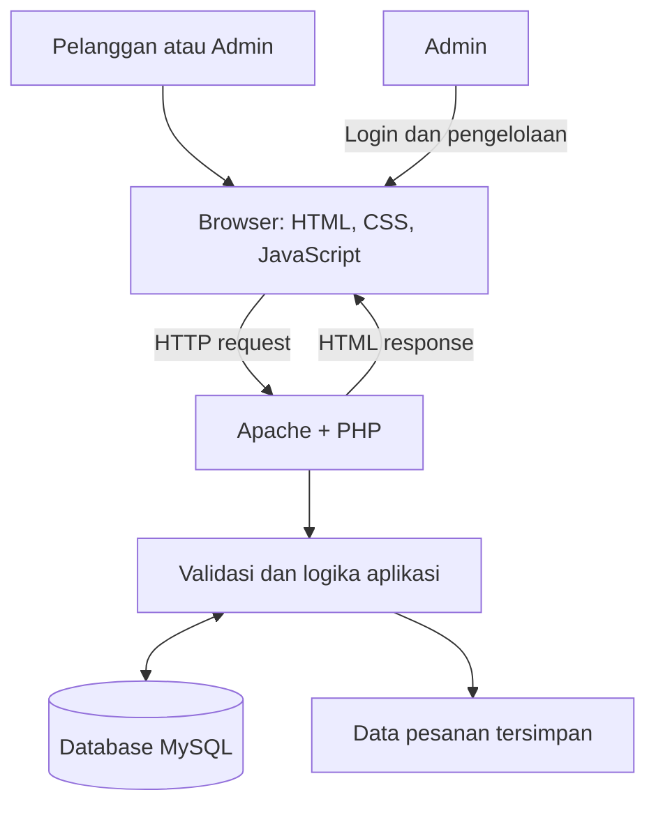
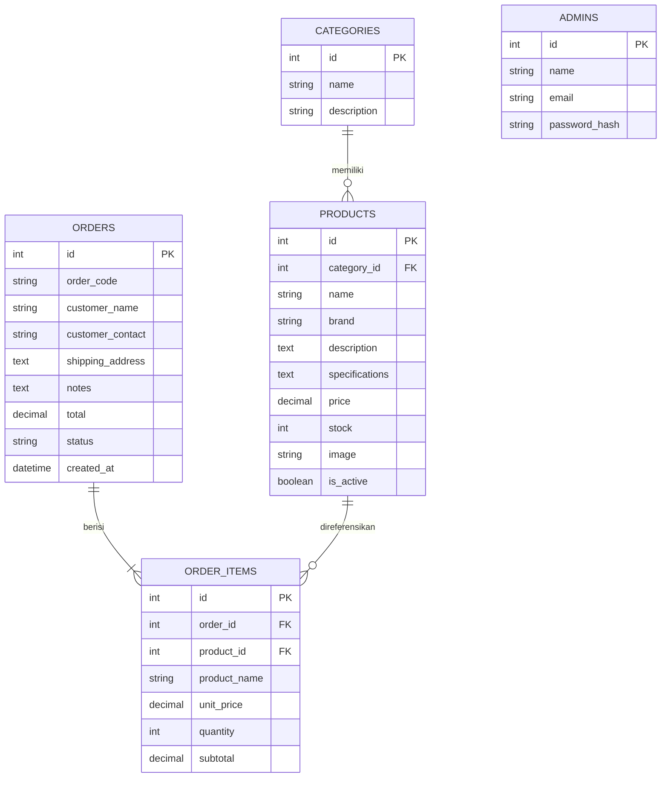

# Arsitektur Sistem — CompTech Store

**Proyek:** E-Commerce Penjualan Sparepart Komputer Berbasis Web  
**Nama website:** CompTech Store  
**Tujuan dokumen:** Menjadi panduan teknis saat menyusun halaman, kode PHP, database MySQL, dan alur kerja website.

## 1. Bentuk Sistem

CompTech Store menggunakan arsitektur website berbasis client-server. Browser menampilkan HTML, CSS, dan JavaScript. PHP memproses permintaan di sisi server dan berkomunikasi dengan MySQL. XAMPP digunakan untuk menjalankan Apache dan MySQL selama pengembangan lokal.



Browser tidak boleh menjadi sumber kebenaran untuk harga, stok, status login, atau total transaksi. Semua data tersebut harus diverifikasi oleh PHP dan database.

## 2. Struktur Berkas yang Disarankan

```text
comptech-store/
├── index.php
├── produk.php
├── detail-produk.php
├── keranjang.php
├── checkout.php
├── pesanan-saya.php          # Opsional bila fitur akun dibuat
├── tentang.php
├── kontak.php
├── config/
│   └── database.php          # Koneksi database; jangan publikasikan kredensial
├── includes/
│   ├── header.php
│   ├── navbar.php
│   ├── footer.php
│   ├── functions.php
│   └── auth.php
├── assets/
│   ├── css/
│   │   └── style.css
│   ├── js/
│   │   └── script.js
│   └── images/
│       ├── logo.png
│       └── products/
├── admin/
│   ├── login.php
│   ├── logout.php
│   ├── index.php             # Dashboard
│   ├── produk/
│   │   ├── index.php
│   │   ├── tambah.php
│   │   ├── edit.php
│   │   └── hapus.php
│   ├── kategori/
│   │   ├── index.php
│   │   ├── tambah.php
│   │   ├── edit.php
│   │   └── hapus.php
│   └── pesanan/
│       ├── index.php
│       ├── detail.php
│       └── ubah-status.php
├── database/
│   └── comptech_store.sql
├── docs/
│   ├── prd.md
│   ├── arsitektur.md
│   └── instruction.md
└── README.md
```

Struktur ini merupakan rekomendasi awal. Jika tugas meminta website lebih sederhana, halaman dapat dikurangi, tetapi pisahkan koneksi database, komponen tampilan, dan halaman admin agar mudah dirawat.

## 3. Teknologi dan Tanggung Jawab

| Teknologi | Tanggung jawab |
| --- | --- |
| HTML | Struktur halaman dan formulir |
| CSS | Layout, warna, responsif, kartu produk, navigasi |
| JavaScript | Interaksi antarmuka, pencarian sisi klien, validasi awal, kontrol jumlah |
| PHP | Routing halaman, validasi sisi server, session, CRUD, checkout |
| MySQL | Menyimpan produk, kategori, admin, pesanan, dan detail pesanan |
| Apache/XAMPP | Menjalankan website di komputer pengembang |

JavaScript boleh membantu pengalaman pengguna, tetapi validasi JavaScript harus selalu dilengkapi validasi PHP.

## 4. Rancangan Database



### Ketentuan model data
- `products.category_id` mengacu pada `categories.id`.
- `orders.id` menjadi induk untuk `order_items.order_id`.
- Simpan `product_name` dan `unit_price` pada detail pesanan sebagai salinan saat transaksi dibuat.
- Gunakan tipe numerik yang sesuai untuk harga dan validasi agar harga tidak negatif.
- Gunakan foreign key dan transaksi database saat membuat pesanan serta detailnya.
- Tentukan kebijakan penghapusan. Produk yang pernah dipesan sebaiknya dinonaktifkan, bukan dihapus permanen jika penghapusan akan merusak riwayat.
- Buat akun admin awal secara aman. Jangan menyimpan password asli di file SQL untuk penggunaan nyata.

## 5. Alur Kerja Halaman

### 5.1 Memuat katalog
1. Browser meminta `produk.php` atau `index.php`.
2. PHP mengambil produk aktif dari MySQL.
3. PHP menyiapkan data dan menghasilkan HTML.
4. Halaman menampilkan foto, nama, kategori, harga, dan stok.
5. Jika hasil kosong atau database gagal diakses, tampilkan pesan yang jelas tanpa menampilkan detail teknis sensitif.

### 5.2 Pencarian dan filter
1. Pengguna mengetik nama produk atau memilih kategori.
2. Untuk katalog sederhana, filter dapat dilakukan dengan JavaScript pada produk yang sudah tampil.
3. Untuk katalog besar, kirim kata kunci dan kategori ke PHP lalu gunakan query berparameter.
4. Pencarian dan filter harus bisa dipakai bersamaan.
5. Jangan menyusun SQL dengan menggabungkan input pengguna secara langsung.

### 5.3 Keranjang
1. Pengguna menambahkan produk dan jumlah.
2. Sistem memvalidasi ID produk dan jumlah.
3. Keranjang dapat disimpan pada session PHP agar tersedia selama sesi; `localStorage` dapat digunakan sebagai opsi antarmuka, tetapi bukan sumber kebenaran transaksi.
4. Saat halaman keranjang dibuka, PHP mengambil harga dan stok terbaru dari database.
5. Subtotal dihitung ulang berdasarkan harga database dan jumlah yang valid.
6. Pengguna dapat mengubah jumlah atau menghapus item.

### 5.4 Checkout dan penyimpanan pesanan
1. Tolak checkout jika keranjang kosong.
2. Validasi nama, kontak, alamat bila pengiriman digunakan, dan catatan.
3. Mulai transaksi database.
4. Ambil data harga dan stok terkini dari database; periksa stok untuk setiap produk.
5. Hitung ulang subtotal dan total di sisi server. Jangan menerima harga atau total dari browser sebagai nilai tepercaya.
6. Simpan data ke `orders` dan item ke `order_items`.
7. Kurangi stok pada tahap yang telah ditentukan secara konsisten, jika alur bisnis menggunakan pengurangan stok saat pesanan dibuat.
8. Commit transaksi jika semua proses berhasil; rollback jika ada kegagalan.
9. Tampilkan kode pesanan dan status yang sebenarnya. Jangan menyatakan pembayaran berhasil jika belum ada integrasi pembayaran.
10. Kosongkan keranjang hanya setelah pesanan tersimpan dengan sukses.

### 5.5 Alur admin
1. Admin membuka halaman login.
2. PHP memeriksa kredensial menggunakan `password_verify()`.
3. Setelah login berhasil, regenerasi ID session.
4. Semua halaman admin memeriksa sesi dan hak akses.
5. Admin mengelola produk, kategori, stok, harga, dan status pesanan.
6. Setiap aksi perubahan data memakai metode POST, validasi server, serta perlindungan CSRF.
7. Tampilkan pesan hasil tanpa membocorkan kredensial atau query database.

## 6. Aturan Perhitungan

- Subtotal per item = harga database × jumlah.
- Total pesanan = penjumlahan seluruh subtotal + biaya tambahan yang benar-benar berlaku.
- Harga menggunakan Rupiah; tampilan format Indonesia, misalnya `Rp3.500.000`.
- Jumlah wajib bilangan bulat positif dan tidak melebihi stok yang tersedia.
- Lakukan perhitungan ulang pada server setiap kali checkout.
- Jika stok berubah ketika checkout, batalkan proses atau minta pengguna menyesuaikan jumlah.
- Gunakan transaksi MySQL untuk menjaga konsistensi antara pesanan, detail pesanan, dan stok.

## 7. Keamanan dan Penanganan Kegagalan

- Gunakan PDO atau MySQLi dengan prepared statements.
- Escape output HTML dengan `htmlspecialchars()`.
- Validasi input di sisi server, termasuk ID, jumlah, harga, status, dan nama file.
- Gunakan `password_hash()` dan `password_verify()` untuk password admin.
- Lindungi halaman admin dengan session; jangan hanya menyembunyikan tautan admin.
- Gunakan token CSRF untuk aksi yang mengubah data.
- Batasi jenis MIME dan ukuran gambar; buat nama file baru dan jangan izinkan file PHP diunggah sebagai gambar.
- Jangan menampilkan stack trace, password, atau detail koneksi database kepada pengguna.
- Tangani kegagalan koneksi database, produk tidak ditemukan, stok tidak cukup, keranjang kosong, input salah, dan kegagalan upload dengan pesan yang mudah dimengerti.
- Pastikan pesan sukses hanya ditampilkan setelah operasi database benar-benar berhasil.

## 8. Desain Antarmuka

- Gunakan identitas merek **CompTech Store** dengan subtitle **Toko Aksesoris dan Sparepart Komputer**.
- Beranda memiliki header/nav, kolom pencarian, banner atau pengantar, kategori, produk pilihan, dan footer.
- Kartu produk menampilkan gambar, nama, harga, dan tombol detail/tambah ke keranjang.
- Gunakan lebar konten terpusat, jarak antarelemen konsisten, dan ukuran gambar yang proporsional.
- Gunakan layout grid/flex untuk katalog dan media query untuk layar kecil.
- Berikan status hover/focus, label formulir, teks alternatif gambar, dan kontras yang cukup.
- Gunakan gambar lokal di `assets/images/products/` dengan nama file yang konsisten.
- Hindari membuat tombol yang hanya dekoratif atau tautan yang tidak berfungsi.

## 9. Menjalankan di XAMPP

1. Instal dan jalankan Apache serta MySQL dari XAMPP.
2. Letakkan folder proyek di `htdocs/comptech-store/`.
3. Buka phpMyAdmin dan buat database bernama `comptech_store`.
4. Impor file `database/comptech_store.sql`.
5. Sesuaikan `config/database.php` dengan host, nama database, username, dan password lokal.
6. Buka `http://localhost/comptech-store/` di browser.
7. Uji halaman pelanggan, keranjang, checkout, login admin, CRUD produk, dan perubahan status pesanan.
8. Sebelum dipublikasikan, ubah kredensial default, gunakan HTTPS, dan pindahkan konfigurasi rahasia ke tempat yang tidak dapat diakses publik.

## 10. Deployment

Untuk penggunaan publik, gunakan hosting yang mendukung versi PHP dan MySQL yang sesuai. Atur HTTPS, kredensial database yang aman, backup database, izin file, dan konfigurasi error agar tidak menampilkan detail internal. Jangan mengunggah file konfigurasi rahasia ke repositori publik.
